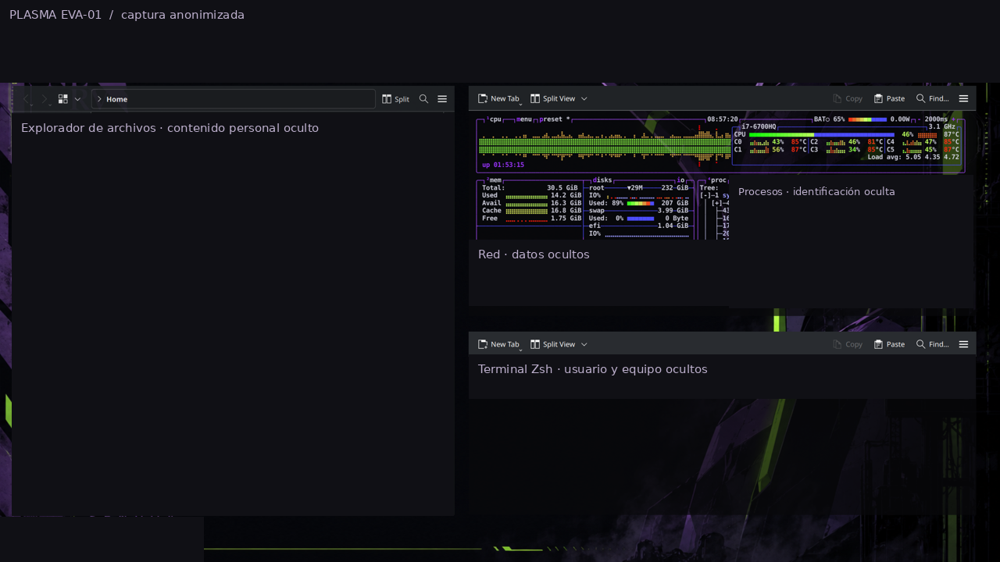
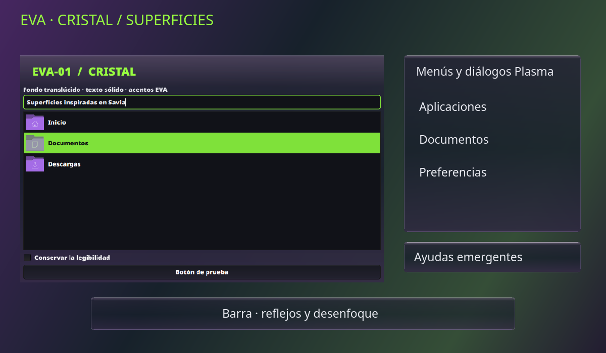
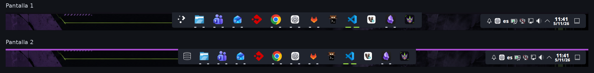
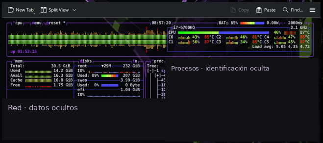
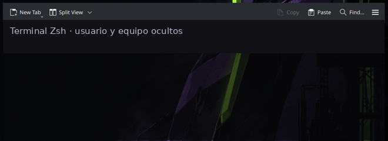
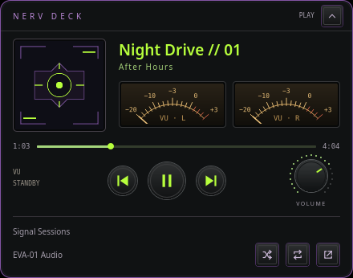

# Plasma EVA-01

Un escritorio KDE Plasma oscuro, con verde vivo y morado: colores, terminales, atajos para teclado de 60 % y superficies de cristal con degradados, reflejos suaves y desenfoque. Instalación por usuario, por componentes y con copia para volver atrás.



> Capturas reales anonimizadas: se han tapado accesos personales, contenido de carpetas, usuario, equipo y datos de red. El fondo ilustrado muestra el entorno de origen; el repositorio no distribuye ni instala ese fondo.

[Cristal en KDE](#cristal-en-kde) · [Instalación](#instalación) · [Barra de tareas](docs/BARRA.md) · [Paneles de escritorio](#paneles-de-escritorio) · [Atajos](#atajos) · [Restaurar](#restaurar) · [NERV Deck](docs/NERV-DECK.md)

## Qué incluye

| Componente | Resultado |
| --- | --- |
| `apariencia` | Esquema EVA01Dark actualizado al estado de noviembre de 2026, iconos Breeze Dark y estilo de Plasma Breeze. |
| `terminales` | Paletas para Kitty, Konsole y Ptyxis; Zsh con ruta y reloj que se actualiza cada segundo. |
| `atajos` | Acciones de ventana y cambio de escritorio con letras y números. |
| `ventanas` | Script de KWin para ordenar ventanas y recuperar la distribución anterior. |
| `acabado` · opcional | Paleta EVA, carpetas moradas, decoración Breeze, desenfoque, animaciones y pantalla de bloqueo. |
| `cristal` · opcional | Ventanas, diálogos y menús Qt Widgets con Kvantum: degradado oscuro, reflejo superior y texto sólido. |
| `cristal-barra` · opcional | Tema Plasma `eva-cristal`: material translúcido para paneles, diálogos y ayudas emergentes. |
| `escritorio` · opcional | Dolphin grande a la izquierda; btop arriba y terminal debajo a la derecha. Inicio automático en KDE. |
| Barra «dos islas» · separada | Aplicaciones centradas y utilidades a la derecha; marcas de estado y favoritos sincronizados entre paneles seleccionados. |
| NERV Deck · separado | Widget multimedia y ventana flotante para Spotify/Spotifast mediante MPRIS. |

El instalador principal conserva la barra de tareas, el fondo, la configuración de pantallas y el número de escritorios. Los paneles de escritorio, la barra «dos islas» y NERV Deck se instalan de forma explícita.

## Cristal en KDE



Esta muestra usa datos ficticios y combina controles Qt reales con recursos SVG del tema; no es una captura de todo el escritorio. El acabado está inspirado en Liquid Glass: grafito y morado, reflejo superior, bordes suaves y desenfoque nativo de KWin. El texto y los iconos permanecen sólidos. Es una aproximación mediante temas SVG, sin refracción dinámica ni deformación del fondo.

Para instalar el conjunto de acabado y cristal sobre tu distribución actual:

```bash
sudo apt install qt-style-kvantum libglib2.0-bin
python3 instalar.py --components acabado cristal cristal-barra          # Revisar el plan
python3 instalar.py --components acabado cristal cristal-barra --apply  # Aplicar con copia
```

Estos componentes son opcionales: `python3 instalar.py --apply` instala únicamente `apariencia`, `atajos`, `ventanas` y `terminales`. El conjunto anterior conserva la distribución de paneles, widgets, favoritos y pantallas; no ejecuta los instaladores de barra ni NERV Deck. `cristal-barra` cambia el estilo visual de Plasma a `eva-cristal`.

El material llega a ventanas y menús Qt Widgets, incluida la vista de Dolphin, y a superficies de Plasma que usan los fondos del tema, como menús del lanzador, calendario, bandeja y ayudas emergentes. Las páginas QML de Ajustes y aplicaciones GTK, Electron o con fondos propios pueden seguir opacas. Se conservan las variantes opacas y la opacidad adaptativa del panel. Algunas aplicaciones abiertas necesitan reabrirse para cargar los recursos nuevos; no se cierran ni se reinicia Plasma al aplicar el cristal.

Comprobado en Plasma 6.6.6 sobre Wayland, con 63 pruebas automatizadas, instalación/restauración aislada y renderizado QtSvg y Kvantum. Consulta el alcance de cada componente a continuación y la [guía de restauración](#restaurar) antes de recuperar una copia.

## Acabado visual EVA-01

El componente opcional `acabado` combina colores oscuros con selección verde, títulos activos verdes e inactivos morados, contorno y sombra Breeze, menús al 94 % de opacidad, desenfoque moderado sin sobresaturación, carpetas moradas y fondo geométrico de bloqueo con reloj siempre visible. Mantiene los efectos de animación elegidos y ajusta su velocidad a 0,65.

```bash
python3 instalar.py --components acabado              # Revisar destinos
python3 instalar.py --components acabado --apply      # Instalar y recargar
```

No aplica `apariencia`, `escritorio` ni los instaladores de barra/NERV Deck: conserva el estilo Plasma actual, disposición y configuración de widgets, paneles, pantallas y fondo de escritorio. Los elementos que siguen la paleta global reflejarán los colores nuevos. Mantiene el bloqueo automático y las opciones de energía. No cambia atajos, terminales ni perfiles de aplicaciones.

[Detalles, compatibilidad, pruebas y restauración](docs/ACABADO.md).

## Transparencia tipo Savia

El componente opcional `cristal` añade fondos de ventanas y diálogos con degradado grafito/morado y reflejo superior, al 86 % de opacidad, y menús al 90 %, con texto sólido, acentos verdes y desenfoque. Utiliza Kvantum para las aplicaciones Qt Widgets, incluida la vista de archivos de Dolphin. Las páginas QML de Ajustes pueden conservar fondos opacos.

```bash
sudo apt install qt-style-kvantum
python3 instalar.py --components cristal             # Revisar destinos
python3 instalar.py --components cristal --apply     # Aplicar con copia
```

Requiere el desenfoque de KWin habilitado, como configura `acabado`. Conserva barra, widgets y pantallas. Reabre las aplicaciones para que carguen el estilo. Consulta [compatibilidad, prueba visual y restauración](docs/CRISTAL.md).

## Barra de cristal

`cristal-barra` añade una superficie translúcida con reflejos, contorno y desenfoque, inspirada en Liquid Glass. Conserva la distribución, iconos, widgets y estados de tareas actuales. Incluye el material de diálogos y ayudas emergentes de Plasma. No necesita Kvantum ni reinstalar la barra. Combínalo con `cristal` para extender el acabado a ventanas y menús Qt Widgets.

```bash
python3 instalar.py --components cristal-barra --apply
```

[Vista previa, requisitos y restauración](docs/CRISTAL-BARRA.md). Es una aproximación de KDE mediante SVG y desenfoque, sin refracción dinámica.

## Requisitos

Entorno de origen: **Ubuntu, KDE Plasma 6.6.6 y Wayland con XWayland**. Otras versiones no se han comprobado.

- Python **3.10+**, `kwriteconfig6` y `qdbus6` para el instalador principal.
- Zsh para `terminales`; instalar las aplicaciones cuyas paletas quieras utilizar.
- Para `cristal`: Kvantum para Qt 6 (`qt-style-kvantum` en Ubuntu) y desenfoque de KWin habilitado.
- Para `cristal-barra`: `gdbus` (`libglib2.0-bin` en Ubuntu), además de las herramientas KDE anteriores.
- Para `escritorio`: Konsole, Dolphin, btop, `kscreen-doctor`, XWayland y el módulo Python `Xlib` (`python3-xlib` en Ubuntu).
- Para NERV Deck: requisitos adicionales en [su guía](docs/NERV-DECK.md).

Usa el Python del sistema (`/usr/bin/python3`) para los paneles. No hace falta instalar dependencias con pip ni ejecutar el instalador con sudo.

## Instalación

```bash
git clone https://github.com/XFunBox/plasma-eva01.git
cd plasma-eva01

# Ver el plan: no escribe archivos.
python3 instalar.py

# Aplicar apariencia, atajos, ventanas y terminales.
python3 instalar.py --apply
```

También puedes escoger solo lo que necesites:

```bash
python3 instalar.py --components apariencia terminales
python3 instalar.py --components apariencia terminales --apply
```

Cada aplicación imprime la ruta de su copia de seguridad. Reabre los terminales y cierra y abre la sesión para cargar todos los cambios de apariencia y atajos. `--no-reload` permite preparar o restaurar los archivos sin contactar con la sesión KDE.

**Cambios en terminales:** Kitty recibe un bloque identificado al final de su configuración; Konsole usa `EVA-01.profile` como perfil predeterminado. El prompt tiene un directorio Zsh propio: no sustituye tu `~/.zshrc`. La paleta de Ptyxis queda disponible para elegirla desde la aplicación, sin fijar un UUID de perfil.

## Barra de tareas



La opción **dos islas** separa las aplicaciones centradas de las utilidades de la derecha. Mantiene los iconos y favoritos existentes. Una marca blanca indica una aplicación abierta; una marca verde más ancha identifica la activa. Los accesos anclados sin abrir quedan sin marca.

El instalador independiente `instalar-barra.py` permite elegir los paneles y guarda una copia previa. La sincronización propaga favoritos y su orden; los ajustes de tamaño, widgets y bandeja siguen siendo independientes. Consulta [instalación, límites y restauración de la barra](docs/BARRA.md).

## Paneles de escritorio



Son aplicaciones reales e interactivas colocadas en la capa del escritorio mediante XWayland y KWin. Se mantienen visibles al mostrar el escritorio y permanecen detrás de las ventanas normales, en todos los escritorios virtuales, y no aparecen en Alt+Tab ni en la barra de tareas. Se reserva una franja superior para los iconos del escritorio. Las reglas exclusivas de KWin fuerzan su posición, tamaño y capa para evitar que queden detrás de Plasma o se redimensionen accidentalmente. Al arrancar se añaden esas tres reglas a `kwinrulesrc`, conservando las demás; la copia inicial de ese archivo se guarda en `${XDG_STATE_HOME:-$HOME/.local/state}/eva01-desktop/kwinrulesrc.before`.

```bash
# Simular y preparar los archivos, sin lanzar aplicaciones.
python3 instalar.py --components escritorio --no-reload
python3 instalar.py --components escritorio --apply --no-reload

# Abrirlos en la sesión actual, o esperar al siguiente inicio de sesión.
/usr/bin/python3 "${XDG_DATA_HOME:-$HOME/.local/share}/eva01-desktop/start.py"
```

La distribución usa como referencia **2560 × 1440** y se adapta al tamaño y escala de la salida. Por defecto busca **`eDP-1`**; si está desactivada no abre los paneles. Para otro nombre, consulta `kscreen-doctor -j` y ejecuta:

```bash
/usr/bin/python3 "${XDG_DATA_HOME:-$HOME/.local/share}/eva01-desktop/start.py" --output eDP-2
```

Para hacerlo permanente, añade ese argumento a `Exec` en `${XDG_CONFIG_HOME:-$HOME/.config}/autostart/eva01-desktop.desktop`. Las posiciones están en `assets/escritorio/layout.py` (`RECTS`), compartidas por el lanzador y las reglas. La distribución está probada en el portátil de origen; otras resoluciones pueden necesitar ajustes.



El perfil exclusivo `EVA-01-Escritorio` usa una opacidad del **72 %** y Dolphin del **88 %**. El reloj deja una columna libre para que su actualización no añada líneas. `TERM` se declara por separado, sin concatenar variables en su valor.

Para cerrar los tres paneles, guarda antes cualquier trabajo en su terminal:

```bash
/usr/bin/python3 "${XDG_DATA_HOME:-$HOME/.local/share}/eva01-desktop/stop.py"
```

Este comando envía SIGTERM únicamente a las aplicaciones marcadas `eva01-desktop-*`. No cierra otras ventanas de Konsole o Dolphin. Para retirarlos permanentemente, ciérralos y restaura la copia creada al instalar `escritorio`; así también se recupera o elimina su entrada de inicio automático. La restauración también recupera `kwinrulesrc` completo desde la copia de instalación: revisa si has añadido otras reglas posteriormente. Los registros, el historial y el archivo de bloqueo que se generan durante el uso no forman parte de esa copia de instalación.

## Atajos

| Teclas | Acción |
| --- | --- |
| Meta + M | Minimizar ventana |
| Meta + X | Maximizar/restaurar |
| Meta + H | Mitad izquierda |
| Meta + W | Vista general |
| Ctrl + Alt + 1 / 2 | Ir al escritorio virtual 1 / 2, si existe |
| Meta + O | Ordenar ventanas |
| Meta + Mayús + O | Restaurar su distribución anterior |

Meta corresponde normalmente a la tecla Windows. Meta + L conserva su función de bloqueo. El componente de ventanas instala un script propio de KWin y un acceso que permite invocarlo mediante el atajo.

## NERV Deck



Vista previa de la interfaz real con datos ficticios, sin información de la sesión.

Controles multimedia con carátula, transporte, progreso y volumen; vista compacta o desplegada y selección de reproductor. La ventana flotante se alterna con **Ctrl + Alt + M**.

```bash
python3 instalar-widget.py             # Simular
python3 instalar-widget.py --apply     # Instalar el paquete
python3 instalar-ventana.py --apply    # Preparar acceso y atajo
```

Después añade **NERV Deck** desde «Añadir widgets» de Plasma. Consulta [la guía completa](docs/NERV-DECK.md) para compatibilidad, funcionamiento y desinstalación. Estos instaladores tienen sus propias copias y comandos de restauración.

## Restaurar

El instalador principal guarda las copias en `${XDG_STATE_HOME:-$HOME/.local/state}/plasma-eva01/backups/`. Usa la ruta exacta que imprimió la instalación:

```bash
# Revisar qué se recuperaría.
python3 instalar.py --restore /ruta/de/la/copia

# Recuperar ese estado.
python3 instalar.py --restore /ruta/de/la/copia --apply
```

La copia contiene solo los archivos de los componentes seleccionados, sus permisos y un manifiesto con sumas SHA-256. Si un archivo no existía, restaurar elimina el que se instaló. Antes de restaurar se crea otra copia del estado sustituido. Los enlaces simbólicos y las copias con rutas o contenido alterados se rechazan.

No restaures una copia antigua sin revisar el plan: devuelve esos archivos completos al estado guardado y puede sustituir cambios posteriores hechos a mano. Para los paneles, ejecuta primero `stop.py` y utiliza `--no-reload`.

## Si algo falla

| Síntoma | Qué comprobar |
| --- | --- |
| Los paneles no aparecen | Salida habilitada y nombre en `kscreen-doctor -j`; dependencias y variable `DISPLAY` de XWayland. |
| Solo aparece parte de los paneles | Archivos `terminal.log`, `btop.log` y `archivos.log` bajo el directorio instalado `eva01-desktop`. Cierra los paneles dedicados y vuelve a arrancarlos. |
| La terminal añade líneas al actualizar el reloj | Reinstala el perfil y prompt actuales; `TERM` debe valer `xterm-256color`, sin variables pegadas con punto y coma. Reabre la terminal. |
| Kitty no carga los colores | Comprueba que no haya un bloque EVA-01 incompleto o duplicado; el instalador informa del problema antes de escribir. |
| No hay sesión KDE disponible | Usa `--no-reload` para preparar archivos; inicia los paneles desde la sesión gráfica. |

## Desarrollo y comprobación

```bash
python3 -m unittest discover -s tests -v
node tests/test_ventanas.cjs
zsh -n assets/terminales/prompt.zsh
```

Las pruebas del instalador usan directorios XDG temporales, incluyendo rutas con espacios, y comprueban simulación, aplicación repetida, restauración, enlaces, copias corruptas y recuperación tras fallos. Las pruebas multimedia usan un bus privado y reproductores de prueba; no requieren credenciales de Spotify. Para ejecutarlas hacen falta las dependencias de desarrollo descritas en [NERV Deck](docs/NERV-DECK.md#pruebas-y-vistas-previas).

```text
assets/             Colores, terminales, script de KWin y paneles
widget/             Paquete de NERV Deck
instalar.py         Instalación por componentes y restauración
instalar-barra.py   Barra dos islas, tema e instalación de sincronización
instalar-widget.py  Instalación de NERV Deck
instalar-ventana.py  Acceso y atajo de su ventana flotante
docs/               Guías e imágenes anonimizadas
tests/              Comprobaciones aisladas
```

## Privacidad y licencias

El repositorio contiene recursos seleccionados y rutas portables. No incluye volcados de `~/.config`, credenciales, claves SSH, historiales, UUID de perfiles, registros de uso ni copias personales. Las imágenes publicadas son versiones anonimizadas; sus originales no se incluyen.

Código propio bajo **MIT**. El esquema KDE adaptado conserva su atribución y licencia **LGPL-2.0-or-later**. Consulta [LICENSE](LICENSE) y [LICENSES.md](LICENSES.md).
