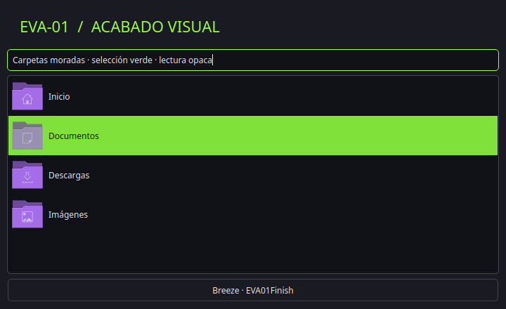

# Acabado visual EVA-01

Componente opcional para KDE Plasma 6.6 con Breeze. No requiere plugins externos ni servicios nuevos. El tema de iconos hereda de Breeze Dark, que debe estar instalado.

## Resultado

- Paleta EVA01Finish: fondo de lectura oscuro y opaco, selección verde con texto oscuro, acentos y carpetas morados.
- Breeze: contorno nativo, borde pequeño y sombra media suave. Los colores del contorno los calcula Breeze a partir del marco/texto activo o inactivo; no es un efecto independiente de neón. Las aplicaciones con decoración propia pueden no usar el marco Breeze.
- Menús Breeze al 94 % de opacidad y desenfoque KWin 10, ruido 2, saturación 100. Solo las superficies que solicitan transparencia/desenfoque participan: el contenido de las aplicaciones sigue opaco. Los widgets conservan su opacidad/configuración propia.
- Iconos EVA01-Breeze: once carpetas/ubicaciones de Breeze con cuerpo morado; el resto hereda Breeze Dark. Las aplicaciones con iconos propios conservan su identidad.
- Bloqueo: fondo SVG propio oscuro con trazos verdes/morados y reloj nativo siempre visible. No sustituye el código de autenticación ni cambia bloqueo automático, suspensión o energía.
- Animaciones: factor global 0,65; conserva los efectos elegidos, sin añadir rebotes o efectos nuevos.



La vista muestra controles Breeze y los iconos resueltos desde el tema instalado; no incluye contenido de la sesión.

## Instalar y deshacer

```bash
python3 instalar.py --components acabado
python3 instalar.py --components acabado --apply
python3 instalar.py --restore /ruta/impresa/de/la/copia --apply
```

Se crea una copia privada con hashes antes de aplicar y antes de restaurar. La restauración recupera bytes y permisos de los archivos originales y elimina los recursos que no existían. Los directorios vacíos pueden permanecer. Las copias de archivos compartidos son completas: restaurarlas más tarde puede deshacer ajustes posteriores en esos archivos.

Solo modifica `kdeglobals`, `kwinrc`, `breezerc`, `kscreenlockerrc` y los recursos propios de colores, iconos y fondo de bloqueo bajo XDG_DATA_HOME. No escribe `plasmarc`, appletsrc, reglas de ventanas, configuración de pantallas ni perfiles de widgets. La paleta y los iconos globales pueden reflejarse en elementos que los heredan.

La recarga avisa a KWin, Breeze y aplicaciones Qt sin reiniciar Plasma ni cerrar ventanas. Algunas aplicaciones conservan sus colores/iconos hasta volver a abrirlas. El fondo de bloqueo se carga al mostrar la pantalla de bloqueo; no se bloquea la sesión automáticamente para probarlo.

## Comprobación

Prueba de integración con HOME/XDG temporales y herramientas KDE reales: simulación sin escrituras, aplicación repetible, conservación de barra/widgets/pantallas/ajustes de bloqueo y restauración exacta. Los SVG se validan y renderizan con QtSvg. Los ocho colores semánticos de selección cumplen contraste de texto 4,5:1 sobre ambos fondos de selección.

Validación en Plasma 6.6.6: 61 pruebas Python y comprobación JavaScript correctas. Aplicación real con copia de seguridad, recarga por D-Bus y 23 archivos de barra/pantallas/widgets sin cambios. Fondo de bloqueo validado como SVG y por configuración; no se ha forzado el bloqueo ni probado la autenticación.

```bash
python3 -m unittest discover -s tests -v
node tests/test_ventanas.cjs
```

## Referencias técnicas

- [Breeze 6.6: esquema de decoración](https://github.com/KDE/breeze/blob/Plasma/6.6/kdecoration/breezesettingsdata.kcfg): Common.OutlineEnabled y opciones de sombra.
- [KWin 6.6: esquema de desenfoque](https://github.com/KDE/kwin/blob/Plasma/6.6/src/plugins/blur/blur.kcfg): BlurStrength, NoiseStrength y Saturation.
- El esquema local de KDecoration confirma BorderSize/BorderSizeAuto; las opciones de reloj se contrastan con el config.qml de bloqueo de Plasma instalado.

Las licencias y fuentes editables de los iconos se incluyen en `assets/acabado/icons/`. El fondo SVG propio usa MIT.
