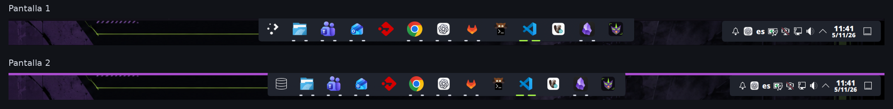

# Barra «dos islas»



Aplicaciones centradas en una isla y utilidades a la derecha en otra. Ambas flotan y se ocultan automáticamente. El tema `eva-islas-estados` usa fondo grafito y mantiene los iconos de la sesión.

- **Aplicación abierta o minimizada:** marca blanca bajo el icono.
- **Aplicación activa:** marca verde más ancha.
- **Acceso anclado sin abrir:** sin marca.

La captura corresponde al equipo de origen, con los favoritos que ya tenía. El repositorio no instala esos accesos personales. El indicador de escritorios virtuales se retiró allí a petición del usuario; el instalador reutilizable conserva los widgets que encuentre.

Para cambiar solo el material de una barra ya configurada, usa el componente [cristal-barra](CRISTAL-BARRA.md): conserva su distribución y no requiere reinstalar las islas.

## Instalar de forma explícita

Requiere KDE Plasma 6, una sesión gráfica activa, `/usr/bin/python3`, `python3-pyqt6`, `qdbus6` y un gestor de servicios systemd de usuario. El diseño se comprobó en Plasma 6.6.6 con dos pantallas de escalas diferentes. Otros tamaños pueden necesitar ajustes para evitar que las islas se solapen.

El instalador principal no activa esta opción. Para consultar los identificadores reales y escoger **los paneles que contienen las aplicaciones**:

```bash
/usr/bin/python3 instalar-barra.py --list
```

Selecciona al menos dos paneles; cada uno debe tener exactamente un «Gestor de tareas solo con iconos». Los números siguientes son un ejemplo: sustitúyelos por los de tu sesión.

```bash
# Revisar los archivos previstos; sin modificar archivos ni paneles.
/usr/bin/python3 instalar-barra.py --panels 3 22

# Aplicar el diseño, instalar el tema y activar la sincronización.
/usr/bin/python3 instalar-barra.py --panels 3 22 --apply
```

La simulación no contacta con Plasma. La presencia de los paneles y sus widgets se valida antes de aplicar.

El primer panel indicado aporta los favoritos iniciales cuando no hay estado previo de sincronización para esa selección. Revisa sus accesos antes de aplicar. El sincronizador podrá sustituir los favoritos distintos del segundo panel por los del primero; la copia inicial guarda la configuración previa para recuperación.

El instalador conserva el panel original para las aplicaciones, con altura de 52 píxeles lógicos, y mueve sus otros widgets a un panel de utilidades de 44 píxeles en la misma pantalla, alineado a la derecha con margen de 18. Conserva los widgets existentes, sus iconos y favoritos; no añade una lista fija de aplicaciones ni cambia la configuración de las pantallas. El tema de Plasma afecta al fondo y estados de todos los paneles de la sesión.

Al finalizar se recarga Plasma para que los widgets movidos se dibujen correctamente. La barra y el escritorio pueden desaparecer brevemente mientras vuelve el shell. El servicio de favoritos se llama `eva-panel-sync.service`.

Si ya existe una instalación de este componente, restaura su copia antes de reinstalar. Aplicar posteriormente `apariencia` con el instalador principal vuelve a seleccionar Breeze; el tema de la barra se puede elegir otra vez desde Preferencias del sistema → Estilo de Plasma.

## Qué se sincroniza

Se sincronizan **los favoritos y su orden** de los gestores seleccionados, en ambas direcciones. El proceso observa los cambios del archivo de Plasma con `QFileSystemWatcher`; agrupa guardados durante 600 ms y reintenta si Plasma no está disponible.

El tamaño, posición, widgets, ajustes de bandeja y tema no se copian continuamente entre paneles. Las aplicaciones abiertas y la ventana activa las muestra el gestor nativo de Plasma; su filtrado por pantalla o escritorio depende de su propia configuración.

Si se editan ambas listas a la vez con resultados distintos, se conservan ambas y se registra el conflicto. Un cambio posterior en una de ellas pasa a ser la referencia. El estado se guarda en `${XDG_STATE_HOME:-$HOME/.local/state}/eva-panel-sync/`, separado por selección de paneles.

```bash
systemctl --user status eva-panel-sync.service
journalctl --user -u eva-panel-sync.service -n 30
```

## Bandeja y utilidades

Las utilidades existentes se trasladan a la isla derecha. La captura tiene la bandeja compactada: red, sonido y notificaciones visibles; otras funciones accesibles desde su flecha. Esta agrupación se configura desde las opciones de cada bandeja y no se impone automáticamente, para conservar las preferencias y utilidades disponibles en cada equipo.

El «Paginador» cambia de escritorio virtual; «Mostrar el escritorio» minimiza o recupera ventanas. Son widgets distintos. Si no usas el primero, puedes quitarlo en el modo de edición de Plasma.

## Restaurar

Cada aplicación imprime la ruta de su copia. Utiliza esa ruta exacta:

```bash
/usr/bin/python3 instalar-barra.py --restore /ruta/de/la/copia
/usr/bin/python3 instalar-barra.py --restore /ruta/de/la/copia --apply
```

La restauración recupera la distribución guardada y los archivos instalados, conservando los favoritos actuales. También devuelve `plasmarc` al estado de la copia: revisa si lo has modificado después de instalar. Solo retira los paneles de utilidades creados por esa instalación. Si les has añadido widgets nuevos, el instalador se detiene antes de retirarlos: muévelos primero a otro panel. También valida que los paneles y widgets originales sigan disponibles.

La copia completa de `plasma-org.kde.plasma.desktop-appletsrc` sirve como evidencia de recuperación manual; no se vuelca sobre la sesión al restaurar, porque eso sustituiría cambios posteriores. Las copias son privadas y no forman parte del repositorio.

## Validación

El diseño, los estados y la sincronización se probaron en la sesión de origen antes de incorporarlos al repositorio. Las pruebas del instalador reutilizable usan directorios XDG temporales y una frontera DBus simulada; la integración del repositorio no vuelve a aplicar el diseño sobre la sesión real.

```bash
/usr/bin/python3 -m unittest discover -s tests -p 'test_barra*.py' -v
```

El tema deriva de Breeze, conserva el resto de recursos mediante herencia y distribuye los SVG editables con su atribución y licencia. Véase [LICENSES.md](../LICENSES.md).
