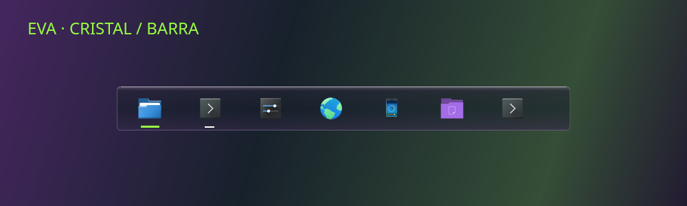

# Barra EVA · cristal



Un acabado inspirado en Liquid Glass: superficie oscura translúcida, reflejo claro en el borde superior, contorno tenue morado, sombra y desenfoque nativo de KWin. Mantiene las marcas de aplicaciones abiertas en blanco y activa en verde. La vista de materiales usa datos ficticios; no representa los favoritos o la disposición del equipo del usuario.

Es una aproximación mediante SVG y el compositor de KDE. No implementa refracción dinámica, deformación del fondo ni animaciones de lente del material de Apple. Véase [la descripción del material de Apple](https://developer.apple.com/design/human-interface-guidelines/materials).

## Aplicar sin reorganizar la barra

```bash
python3 instalar.py --components cristal-barra
python3 instalar.py --components cristal-barra --apply
```

El componente instala el estilo separado `eva-islas-cristal` y selecciona ese estilo de Plasma. No ejecuta `instalar-barra.py`, no mueve ni añade widgets, no cambia favoritos, alturas, ocultación, pantallas ni sincronización. Conserva el tema anterior para volver a seleccionarlo. El estilo se aplica a todos los paneles de la sesión.

Requiere Plasma 6, `kwriteconfig6`, `qdbus6`, `gdbus` (paquete Ubuntu `libglib2.0-bin`) y sesión gráfica. No necesita Kvantum. Activa el efecto Desenfoque de KWin; `acabado` ya lo hace. La variante normal y `translucent` usan el cristal; las variantes `opaque` y `solid` conservan el fondo opaco como alternativa cuando Plasma lo solicita. La opacidad adaptativa del panel sigue siendo la elegida por el usuario.

La recarga usa la notificación nativa de KConfig; no reinicia Plasma. `--no-reload` prepara archivos sin contactar con la sesión y requiere cargar el estilo posteriormente.

## Restaurar

```bash
python3 instalar.py --restore /ruta/exacta/de/la/copia
python3 instalar.py --restore /ruta/exacta/de/la/copia --apply
```

La copia guarda `plasmarc` y los archivos del estilo instalado. Restaurar recupera el archivo completo; revisa si has hecho cambios posteriores en él. No recupera ni modifica la distribución de paneles porque este componente no la toca.

## Comprobación y licencias

Prueba aislada de simulación, instalación y restauración exacta, con conservación de configuración de paneles, widgets y estilo de ventanas. Las imágenes SVG se comprueban con QtSvg. La notificación de cambio de tema se verificó en un bus privado como `a{saay}`, con el grupo `Theme` y la clave `name`.

Los recursos derivan del tema Breeze/EVA existente, conservan máscaras y márgenes e incluyen SVG editables, atribución KDE y LGPL-2.0-or-later. Los estados de tareas se reutilizan sin cambios.
