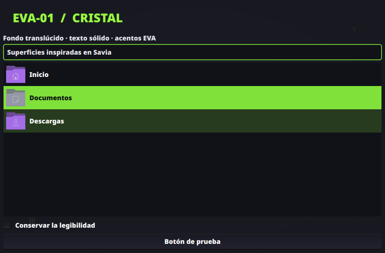

# Cristal EVA-01

Componente opcional inspirado en Savia: superficies oscuras con fondo translúcido, texto sólido y selecciones verdes legibles. No reduce la opacidad de toda la ventana mediante reglas de KWin.



La imagen muestra controles Qt reales de Kvantum sobre un fondo de prueba; no es una captura de Dolphin o Ajustes. El fondo de ventana tiene una opacidad aproximada del 86 % y los menús del 90 %. Campos, selecciones y ciertos controles conservan superficies sólidas para facilitar la lectura.

## Instalación

En Ubuntu, instala el motor desde los repositorios de la distribución:

```bash
sudo apt install qt-style-kvantum
python3 instalar.py --components cristal
python3 instalar.py --components cristal --apply
```

Ejecuta el instalador como usuario habitual, sin sudo. Exige el complemento Qt6 instalado antes de aplicar y recargar el estilo. `--no-reload` permite preparar archivos sin comprobar el motor: no es una forma de activarlo sin Kvantum.

Activa el efecto Desenfoque de KWin antes de usarlo. El componente `acabado` ya lo habilita; puedes seleccionar ambos componentes si aún no lo has aplicado. Reabre las aplicaciones que quieras actualizar. No hace falta reiniciar Plasma.

## Compatibilidad y alcance

- Plasma 6 / Wayland: probado con una ventana Qt6 real. El atributo de fondo translúcido está activo, el canal alfa del fondo es 219/255 y la opacidad global de ventana permanece en 1,0.
- Dolphin: Kvantum habilita la transparencia de su vista de archivos, además del fondo Qt Widgets. Sus preferencias de vista siguen siendo propias de Dolphin.
- Ajustes del sistema: el contenedor Qt Widgets puede usar el estilo; las páginas QML incrustadas pueden mantener fondos opacos. No se garantiza transparencia uniforme en todas sus páginas.
- Aplicaciones GTK, Electron, navegadores y ventanas Qt Quick independientes no adoptan este estilo de controles. No se les aplican reglas de opacidad global.
- La barra de tareas y los widgets de Plasma conservan su tema y distribución. No modifica pantallas, atajos ni opciones de bloqueo automático.

Instala el tema editable en `~/.config/Kvantum/EVA01Glass/`, selecciona `EVA01Glass` en la configuración de Kvantum y cambia únicamente `KDE/widgetStyle` a `kvantum` en `kdeglobals`. Conserva las demás opciones existentes y las asignaciones por aplicación de Kvantum. Una asignación previa puede hacer que una aplicación siga usando otro tema.

Comprobación nativa en Plasma 6.6.6: Dolphin y Ajustes cargaron el complemento Qt6 de Kvantum en procesos de prueba separados. Las capturas de ventana conservaron alfa 219 en 544 434 píxeles de Dolphin y 68 107 de Ajustes; la mayoría de la página inicial de Ajustes permaneció opaca. Estas capturas de sesión no se distribuyen. Las aplicaciones que ya estaban abiertas pueden seguir usando el estilo anterior hasta reabrirse.

## Restauración y pruebas

La instalación imprime la ruta de su copia. Para recuperar el estilo y los archivos anteriores:

```bash
python3 instalar.py --restore /ruta/exacta/de/la/copia
python3 instalar.py --restore /ruta/exacta/de/la/copia --apply
```

La restauración recupera archivos completos; revisa el plan si has hecho cambios posteriores. No desinstala el paquete Kvantum del sistema.

La prueba aislada cubre simulación, instalación, conservación de barra y configuración de pantallas, y restauración exacta de archivos y permisos. La prueba visual utiliza Kvantum 1.1.5 para Qt6 y datos ficticios. Los recursos derivan de [Kvantum](https://github.com/tsujan/Kvantum), bajo GPL-3.0-or-later, con licencia y atribución en el directorio del tema.
